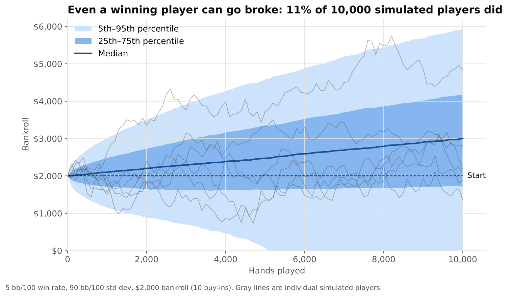

# Poker Bankroll Risk Model

A Monte Carlo simulation of risk of ruin, drawdowns and capital sizing, built in both **Excel** and **Python**.

**The question:** a player with a real edge still faces large swings. How much capital do they need so that bad luck doesn't wipe them out before the edge pays off? It's the same problem a trader, fund or startup faces: positive expected return, high volatility, and capital that can hit zero first.

## Key findings (5 bb/100 win rate, 90 bb/100 std dev, 10 buy-in bankroll)

- About **11%** of 10,000 simulated winning players went broke within 10,000 hands, and about **29%** would eventually go broke with no time limit.
- About **3 in 10** finished 10,000 hands below their starting bankroll despite winning on average.
- The median worst downswing was about **8 buy-ins**.
- This player needs about **24 buy-ins** for a 5% risk of ruin. Doubling the win rate cuts that roughly in half.

## What's in the repo

| File | What it is |
|---|---|
| `Poker_Bankroll_Risk_Model.xlsx` | Formula-driven Excel model: 500 simulated paths, a results dashboard, a sensitivity table and charts. Change the blue inputs and press F9 to re-run. |
| `Poker_Bankroll_Risk_Model.ipynb` | Python version: 10,000 vectorized paths (NumPy), validation against closed-form math, a convergence test and a sensitivity heatmap. |
| `charts/` | Charts exported from the notebook. |

## Method

- Results are simulated in blocks of 100 hands, each drawn from a normal distribution with the player's win rate and standard deviation. A path that hits $0 stays at $0.
- **Max drawdown** is the largest peak-to-trough drop on each path, the same metric used for funds and trading strategies.
- **Validation:** simulated risk of ruin is checked against the closed-form result for a random walk with drift (reflection principle) across several bankroll sizes. The small gap that remains is discretization bias from checking the bankroll only every 100 hands.
- **Convergence:** the running estimate and its 95% confidence band show how many paths are needed for a stable answer.

## Limitations and next steps

- The win rate is treated as known; in reality it's estimated with error, which makes true risk higher.
- Ruin is defined as $0, ignoring move-down-in-stakes or stop-loss rules.
- Normal block results understate extreme swings; a fat-tailed (Student's t) version would stress-test this.

## Tools

Excel · Python · NumPy · pandas · SciPy · Matplotlib
