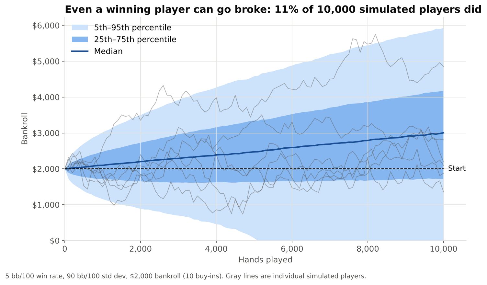

# Poker Bankroll Risk Model

**Project page:** https://breachedbym1.github.io/bankroll-risk-model/ · **Portfolio:** https://breachedbym1.github.io

I play poker and kept running into the same question: if I'm a winning player, how much money do I actually need so a bad run doesn't wipe me out before the wins show up? The usual answer is "20-30 buy-ins," but nobody explains where that number comes from. So I built a model to figure it out.

I simulated 10,000 players with the exact same skill and bankroll and tracked how many went broke, how deep their losing streaks got, and how much bankroll it takes to make going broke unlikely. I built it in Excel first, then rebuilt it in Python so I could run more simulations and check the results against the math.

Turns out it's the same problem traders and startups deal with: you can have an edge and still run out of money before it pays off.

## What I found
Assumptions: 5 bb/100 win rate, 90 bb/100 std dev, $2,000 bankroll (10 buy-ins), 10,000 hands.

- **11%** of the simulated players went broke within 10,000 hands even though every one of them was a winning player. If they kept playing forever, it's about **29%**.
- About **3 in 10** finished below where they started.
- The typical worst downswing was about **8 buy-ins**.
- To get the risk of going broke down to 5%, you need about **24 buy-ins**. Doubling your win rate cuts that roughly in half.

## Files

| File | What it is |
|---|---|
| `Poker_Bankroll_Risk_Model.xlsx` | Excel version: 500 simulated paths, summary tab, sensitivity table and charts. Change the blue inputs and press F9 to re-run. |
| `Poker_Bankroll_Risk_Model.ipynb` | Python version: 10,000 paths in NumPy, checked against closed-form math, plus a convergence test and a sensitivity heatmap. |
| `Poker_Bankroll_Simulation.mp4` | Animated replay of two simulated players with the same edge and opposite outcomes. |
| `charts/` | Charts from the notebook. |

## How it works

- Each block of 100 hands is drawn from a normal distribution using the win rate and standard deviation. If a player hits $0, they stay at $0.
- **Max drawdown** is the biggest drop from a high point to a later low, the same way funds measure their worst losing stretch.
- **Checking the model:** I compared the simulated risk of ruin to the closed-form formula for a random walk with drift. They line up, with a small gap because the simulation only checks the bankroll every 100 hands and misses dips in between.
- **How many simulations is enough:** the estimate settles after a few thousand runs; 10,000 gets it within about ±0.6 percentage points.

## What's next (in progress)

- Treat the win rate as uncertain instead of known, since you never really know your true win rate. This should push the risk up.
- Add a "move down in stakes" rule and see how much it lowers the risk.
- Swap the normal distribution for one with fatter tails to stress-test big swings.
- Turn it into an interactive app with sliders.
- Use the same approach on a project budget to estimate the chance it finishes on budget.

## Tools

Excel · Python · NumPy · pandas · SciPy · Matplotlib

---

Built by **Diego Reed**, Finance @ James Madison University · [LinkedIn](https://www.linkedin.com/in/diego-reed-625485384/)
